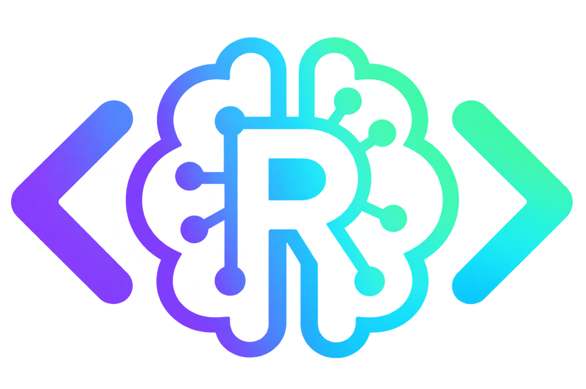

<p align="center">
  
</p>

<h1 align="center">rcodeagent</h1>

<p align="center"><strong>0.1.0</strong></p>

An AI coding assistant for RStudio. Ask questions, understand results, improve R scripts and make targeted edits without leaving the Viewer pane.

Sign in with ChatGPT through native OAuth. No API key or Codex CLI is required. Access to models depends on your account and service availability.

The plugin interface is available in **English and Spanish**, with **English as the default**. Your saved language selection is remembered. This setting changes only the plugin's menus, buttons and interface messages. It does not change your prompts or control the language of the AI conversation: you can communicate with the model in your preferred language, independently of the interface setting.

## Quick installation

You need **R 4.2 or later**, **RStudio Desktop** and an **eligible ChatGPT Plus or Pro subscription**. OpenAI's [Sign in with ChatGPT quickstart](https://developers.openai.com/siwc/quickstart) specifies Plus and Pro eligibility for model requests through this open-source integration. **ChatGPT Free is not supported for model usage.** Signing in alone does not authorize inference: your account must grant ChatGPT plan usage, and available models and limits depend on OpenAI's current policies.

Install directly from [GitHub](https://github.com/gmoncayoj/rcodeagent) using `remotes`, then launch the assistant inside RStudio:

```r
install.packages("remotes") # First time only
remotes::install_github("gmoncayoj/rcodeagent", upgrade = "never")
rcodeagent::rcodeagent()
```

PDF conversation export requires an R installation with Cairo support. On macOS, install [XQuartz](https://www.xquartz.org/) for this feature.

You can also launch the assistant from **Addins → rcodeagent**. Sign in, choose an available model and start in **Normal** mode.

After disconnecting, choose **Use another account** to authorize a different ChatGPT account. Check the identity shown in your browser before approving access.

## A quick example

Open an R script containing:

```r
scores <- c(12, 15, NA, 18, 20)
mean(scores)
```

Capture the active file in the assistant and ask:

> Why does this return NA? Show me how to calculate the mean using the valid scores.

The missing value causes `mean(scores)` to return `NA`. The corrected calculation is:

```r
mean(scores, na.rm = TRUE)
# [1] 16.25
```

**Normal** explains and generates code in chat. To apply a change to the selected script, enable **Auto** and explicitly request the edit. Code runs only when you explicitly request execution; saving remains manual.

## Usage considerations

Review generated code and results, and report problems with synthetic examples. Automated tests use synthetic credentials and mocked service responses; native sign-in and model access require an eligible account.

Code submitted for execution uses your R session permissions and may be queued by RStudio. Selected context is sent to the authorized service. Share only code and data you are authorized to send. Credentials remain in the operating-system credential store; local histories and exports must also be handled as potentially sensitive files.

## Documentation

- [English user manual](docs/manual/rcodeagent-0.1.0-Manual-EN.pdf)
- [Spanish user manual](docs/manual/rcodeagent-0.1.0-Manual-ES.pdf)

**Author and maintainer:** José Gamarra-Moncayo

**License:** [GNU GPL version 3 or later](LICENSE.md).

## Independence and trademarks

rcodeagent is an independent project developed and maintained by José Gamarra-Moncayo. It is not affiliated with, sponsored by or endorsed by OpenAI or Posit Software, PBC. References to their products describe compatibility and integration only; they do not imply a partnership or an official product.

OpenAI and ChatGPT are trademarks of OpenAI. Posit, RStudio, and Shiny are trademarks of Posit Software, PBC, all rights reserved, and may be registered in the United States Patent and Trademark Office and in other countries. All other trademarks belong to their respective owners.
